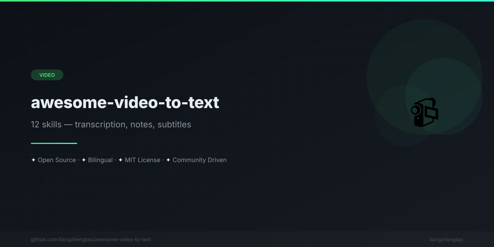

[English](README.md) | [中文](README.zh.md) | [日本語](README.ja.md) | [Français](README.fr.md) | [Español](README.es.md) | [العربية](README.ar.md) | [한국어](README.ko.md) | [Português](README.pt.md) | [Русский](README.ru.md) | [Deutsch](README.de.md)

<div align="center">



</div>


<div align="center">

# Awesome Video to Text

[](https://awesome.re)
[](CONTRIBUTING.md)
[](LICENSE)
[](#المهارات)

**حوّل أي فيديو إلى نص منظم.**

12 مهارة ذكاء اصطناعي للنسخ والتلخيص والملاحظات والترجمة.

</div>

---

## نظرة عامة

**فيديو محاضرة ساعتين → ملاحظات دراسية منظمة مع النقاط الرئيسية والفصول وبطاقات المراجعة والترجمة.**

```
قبل: 📹 lecture_recording.mp4 (ساعتان، 1.2 جيجابايت)
بعد:  📝 lecture_notes.md (ملاحظات كورنيل منظمة)
      📋 key_points.json (رؤى محددة زمنياً)
      👑 chapters.txt (فصول جاهزة لليوتيوب)
      🃏 flashcards.apkg (بطاقات Anki للتكرار المتباعد)
      🎯 quiz.json (أسئلة تقييم ذاتي)
      📄 subtitles.srt (صيني + إنجليزي)
```

هذا المستودع هو مجموعة منتقاة من **مهارات الذكاء الاصطناعي** التي تستخرج المحتوى من الفيديوهات وتنظمه إلى نص منظم وقابل للبحث. استخدم هذه المهارات في Cursor أو Claude Code أو Kimi Code أو أي مساعد برمجة ذكاء اصطناعي.

---

## المهارات

### النسخ

| المهارة | الوصف | الميزات الرئيسية |
|-------|-------------|--------------|
| [Whisper Transcription](skills/转录技术/whisper-transcription.md) | نسخ الفيديو محلياً باستخدام OpenAI Whisper | تحسين GPU، المعالجة الدفعية، 99 لغة |
| [YouTube Transcript](skills/转录技术/youtube-transcript.md) | استخراج النصوص من فيديوهات يوتيوب | ترجمات تلقائية، معالجة قوائم تشغيل، متعدد اللغات |
| [Meeting Transcription](skills/转录技术/meeting-transcription.md) | نسخ الاجتماعات والمقابلات مع تحديد المتحدث | فصل المتحدثين، عناصر إجرائية، الوضع المباشر |

### استخراج المحتوى

| المهارة | الوصف | الميزات الرئيسية |
|-------|-------------|--------------|
| [Video Summarization](skills/内容提取/video-summarization.md) | تلخيص محتوى الفيديو | استخلاصي + انتزاعي، ملخصات الفصول، أنواع متعددة |
| [Key Points Extraction](skills/内容提取/key-points-extraction.md) | استخراج النقاط الرئيسية والرؤى | اقتباسات، قرارات، عناصر إجرائية، استخراج كلمات مفتاحية |
| [Chapter Generation](skills/内容提取/chapter-generation.md) | إنشاء فصول الفيديو والطوابع الزمنية | تقسيم المواضيع، تنسيق يوتيوب/بودكاست، عناوين SEO |

### تنظيم الملاحظات

| المهارة | الوصف | الميزات الرئيسية |
|-------|-------------|--------------|
| [Video Notes](skills/笔记整理/video-notes.md) | تنظيم الملاحظات من الفيديوهات | طريقة كورنيل، خرائط ذهنية، تنسيق مخطط |
| [Knowledge Extraction](skills/笔记整理/knowledge-extraction.md) | استخراج وتنظيم المعارف | خرائط المفاهيم، تكامل Obsidian، قاعدة بيانات الرسم البياني |

### معالجة الترجمة

| المهارة | الوصف | الميزات الرئيسية |
|-------|-------------|--------------|
| [Subtitle Generation](skills/字幕处理/subtitle-generation.md) | إنشاء ترجمات تلقائية | صيغ SRT/ASS/VTT، تخصيص النمط، مزامنة التوقيت |
| [Subtitle Translation](skills/字幕处理/subtitle-translation.md) | ترجمة الترجمات | ترجمات ثنائية اللغة، تكييف ثقافي، ضبط التوقيت |

### مساعدة التعلم

| المهارة | الوصف | الميزات الرئيسية |
|-------|-------------|--------------|
| [Lecture Notes](skills/学习辅助/lecture-notes.md) | تنظيم ملاحظات المحاضرات والدورات | بطاقات Anki، إنشاء اختبارات، تكرار متباعد |
| [Tutorial Documentation](skills/学习辅助/tutorial-documentation.md) | توثيق البرامج التعليمية من الفيديوهات | استخراج الخطوات، التقاط الأكواد، تكامل MkDocs |

---

## البدء السريع

### Cursor

1. قم باستنساخ أو تحميل هذا المستودع
2. افتح مشروعك في Cursor
3. انسخ محتوى ملف المهارة إلى `.cursorrules` أو اذكره في المحادثة
4. اطلب من Cursor معالجة الفيديو

```
@whisper-transcription.md Transcribe my lecture video at ./videos/lecture.mp4
```

### Claude Code

1. قم باستنساخ هذا المستودع إلى مشروعك
2. اذكر المهارات في التوجيهات

```bash
# In your project directory
claude "Using the whisper-transcription skill, transcribe ./video.mp4 and generate study notes"
```

### Kimi Code

1. أضف هذا المستودع كمصدر مهارات
2. اذكر المهارات باستخدام `/skill` أو بتضمين ملف المهارة

```bash
kimi "Follow skills/转录技术/whisper-transcription.md to transcribe my video"
```

---

## مقارنة الأدوات

| الأداة | السرعة | الجودة | التكلفة | بدون إنترنت | الأفضل لـ |
|------|-------|---------|------|---------|----------|
| **Whisper (محلي)** | متوسط | ★★★★☆ | مجاني | نعم | الخصوصية، المعالجة الدفعية |
| **Whisper API** | سريع | ★★★★☆ | $0.006/دقيقة | لا | النسخ السريع لمرة واحدة |
| **faster-whisper** | سريع | ★★★★☆ | مجاني | نعم | خطوط إنتاج |
| **whisper.cpp** | سريع | ★★★★☆ | مجاني | نعم | بدون بيئة Python |
| **Google Cloud STT** | سريع | ★★★★☆ | $0.006/دقيقة | لا | البث المباشر |
| **Azure Speech** | سريع | ★★★★★ | $1/ساعة | لا | المؤسسات، تحديد المتحدث |
| **AssemblyAI** | سريع | ★★★★★ | $0.015/دقيقة | لا | نسخ الاجتماعات |

### دليل اختيار النموذج

| نموذج Whisper | الحجم | السرعة | الجودة | VRAM | التوصية |
|---------------|------|-------|---------|------|----------------|
| `tiny` | 39M | ~32x | ★★☆☆☆ | ~1GB | المسودات السريعة فقط |
| `base` | 74M | ~16x | ★★★☆☆ | ~1GB | صوت نظيف، مقاطع قصيرة |
| `small` | 244M | ~6x | ★★★★☆ | ~2GB | توازن جيد |
| `medium` | 769M | ~2x | ★★★★☆ | ~5GB | **معظم الاستخدامات** |
| `large-v3` | 1.5G | 1x | ★★★★★ | ~10GB | أقصى دقة |
| `turbo` | 809M | ~8x | ★★★★☆ | ~6GB | **أفضل سرعة/جودة** |

---

## هيكل المشروع

```
awesome-video-to-text/
├── README.md
├── README.zh.md
├── LICENSE
├── CONTRIBUTING.md
├── SECURITY.md
├── CODE_OF_CONDUCT.md
├── CHANGELOG.md
├── .gitignore
├── .github/
│   ├── workflows/
│   │   └── ci.yml
│   ├── ISSUE_TEMPLATE/
│   │   ├── bug_report.md
│   │   ├── feature_request.md
│   │   └── new_skill.md
│   └── pull_request_template.md
└── skills/
    ├── 转录技术/                    # Transcription
    │   ├── whisper-transcription.md
    │   ├── youtube-transcript.md
    │   └── meeting-transcription.md
    ├── 内容提取/                    # Content Extraction
    │   ├── video-summarization.md
    │   ├── key-points-extraction.md
    │   └── chapter-generation.md
    ├── 笔记整理/                    # Note Organization
    │   ├── video-notes.md
    │   └── knowledge-extraction.md
    ├── 字幕处理/                    # Subtitle Processing
    │   ├── subtitle-generation.md
    │   └── subtitle-translation.md
    └── 学习辅助/                    # Learning Aid
        ├── lecture-notes.md
        └── tutorial-documentation.md
```

---

## انظر أيضًا

- [awesome-video-skills](https://github.com/Serennity007/awesome-video-skills) - مهارات الذكاء الاصطناعي لتحرير ومعالجة الفيديو
- [awesome-video-prompts](https://github.com/Serennity007/awesome-video-prompts) - توجيهات منتقاة لذكاء الفيديو الاصطناعي
- [awesome-skills](https://github.com/Serennity007/awesome-skills) - مجموعة عامة من مهارات الذكاء الاصطناعي
- [awesome-ai-rules](https://github.com/Serennity007/awesome-ai-rules) - قواعد وتكوينات مساعدي البرمجة بالذكاء الاصطناعي

---

## المساهمة

نرحب بالمساهمات! انظر [CONTRIBUTING.md](CONTRIBUTING.md) للإرشادات.

- إضافة مهارات جديدة
- تحسين المهارات الحالية
- إصلاح الأخطاء والأخطاء المطبعية
- ترجمة المحتوى

---

## الترخيص

هذا المشروع مرخص بموجب ترخيص MIT - راجع ملف [LICENSE](LICENSE) للتفاصيل.

حقوق النشر (c) 2024 liangzhengtao

---

<div align="center">

**صُنع بـ ❤️ لمجتمع تحويل الفيديو إلى نص**

</div>
