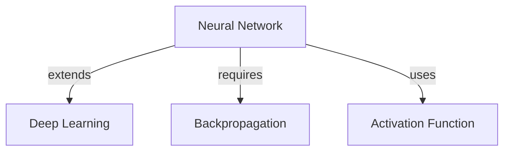

# Knowledge Extraction and Organization

Extract, organize, and link knowledge from video content into structured knowledge bases, concept maps, and interconnected note systems.

## When to Use

- Building a personal knowledge base from video courses
- Creating concept maps from lecture series
- Organizing technical knowledge from tutorial videos
- Linking related concepts across multiple videos
- Preparing reference material from conference recordings
- Creating a wiki from educational video content

## Tools and Software

### Required

| Tool | Version | Purpose |
|------|---------|---------|
| [OpenAI Whisper](https://github.com/openai/whisper) | Latest | Video transcription |
| [OpenAI API](https://platform.openai.com/) | GPT-4o | Knowledge extraction |

### Optional

| Tool | Purpose |
|------|---------|
| [Obsidian](https://obsidian.md/) | Knowledge base storage |
| [Neo4j](https://neo4j.com/) | Graph database |
| [NetworkX](https://networkx.org/) | Graph analysis |
| [spaCy](https://spacy.io/) | NLP entity extraction |

### Installation

```bash
# Core
pip install openai-whisper openai

# Graph tools
pip install networkx spacy
python -m spacy download en_core_web_sm

# Optional: Neo4j
# Docker
docker run -d --name neo4j -p 7474:7474 -p 7687:7687 neo4j
```

## Step-by-Step Workflow

### Step 1: Transcribe Multiple Videos

```python
# Transcribe a series of videos
```

### Step 2: Extract Concepts

```python
# Identify key concepts, definitions, relationships
```

### Step 3: Build Knowledge Graph

```python
# Create nodes and edges between concepts
```

### Step 4: Generate Linked Notes

```python
# Create interconnected markdown notes
```

## Code Templates

### Template 1: Knowledge Base Builder

```python
#!/usr/bin/env python3
"""Build a knowledge base from video content."""

import whisper
import json
import networkx as nx
from pathlib import Path
from openai import OpenAI
from datetime import datetime


class KnowledgeBaseBuilder:
    """Extract and organize knowledge from videos."""
    
    def __init__(self, whisper_model: str = "medium", llm_model: str = "gpt-4o"):
        self.whisper = whisper.load_model(whisper_model)
        self.llm = OpenAI()
        self.llm_model = llm_model
        self.graph = nx.DiGraph()
        self.concepts = {}
    
    def process_video(self, video_path: str, language: str = None) -> dict:
        """Process a single video and extract knowledge."""
        
        # Transcribe
        print(f"Transcribing: {video_path}")
        result = self.whisper.transcribe(video_path, language=language)
        transcript = result["text"]
        
        # Extract concepts and relationships
        print("Extracting concepts...")
        knowledge = self._extract_knowledge(transcript)
        
        # Add to graph
        self._build_graph(knowledge)
        
        # Store concepts
        for concept in knowledge.get("concepts", []):
            key = concept["name"].lower()
            if key not in self.concepts:
                self.concepts[key] = {
                    "name": concept["name"],
                    "definition": concept["definition"],
                    "category": concept.get("category", "general"),
                    "sources": [video_path],
                    "related": concept.get("related", [])
                }
            else:
                self.concepts[key]["sources"].append(video_path)
        
        return knowledge
    
    def _extract_knowledge(self, transcript: str) -> dict:
        """Extract concepts and relationships from transcript."""
        
        response = self.llm.chat.completions.create(
            model=self.llm_model,
            messages=[
                {"role": "system", "content": """Extract knowledge from this transcript.

Return a JSON object with:
- "concepts": list of concepts, each with:
  - "name": concept name
  - "definition": clear definition
  - "category": one of [theory, technique, tool, principle, fact]
  - "importance": high/medium/low
  - "related": list of related concept names

- "relationships": list of relationships, each with:
  - "source": source concept name
  - "target": target concept name
  - "type": one of [is_a, part_of, requires, enables, contradicts, extends]
  - "description": brief description

Return ONLY valid JSON."""},
                {"role": "user", "content": transcript[:10000]}
            ],
            max_tokens=3000,
            temperature=0.2
        )
        
        try:
            return json.loads(response.choices[0].message.content)
        except json.JSONDecodeError:
            return {"concepts": [], "relationships": []}
    
    def _build_graph(self, knowledge: dict):
        """Add concepts and relationships to graph."""
        
        for concept in knowledge.get("concepts", []):
            self.graph.add_node(
                concept["name"],
                definition=concept["definition"],
                category=concept.get("category", "general"),
                importance=concept.get("importance", "medium")
            )
        
        for rel in knowledge.get("relationships", []):
            if rel["source"] in [c["name"] for c in knowledge.get("concepts", [])]:
                if rel["target"] in [c["name"] for c in knowledge.get("concepts", [])]:
                    self.graph.add_edge(
                        rel["source"],
                        rel["target"],
                        type=rel["type"],
                        description=rel.get("description", "")
                    )
    
    def generate_obsidian_notes(self, output_dir: str):
        """Generate Obsidian-compatible linked notes."""
        
        output_path = Path(output_dir)
        output_path.mkdir(parents=True, exist_ok=True)
        
        for key, concept in self.concepts.items():
            # Create note for each concept
            filename = concept["name"].replace(" ", "_") + ".md"
            
            lines = [
                f"# {concept['name']}",
                "",
                f"**Category**: {concept['category']}",
                f"**Sources**: {', '.join(concept['sources'])}",
                "",
                "## Definition",
                concept["definition"],
                "",
            ]
            
            # Related concepts with wikilinks
            if concept.get("related"):
                lines.append("## Related Concepts")
                for related in concept["related"]:
                    lines.append(f"- [[{related}]]")
                lines.append("")
            
            # Graph neighbors
            if concept["name"] in self.graph:
                neighbors = list(self.graph.neighbors(concept["name"]))
                predecessors = list(self.graph.predecessors(concept["name"]))
                
                if neighbors:
                    lines.append("## Leads To")
                    for n in neighbors:
                        edge = self.graph[concept["name"]][n]
                        rel_type = edge.get("type", "related")
                        lines.append(f"- [[{n}]] ({rel_type})")
                    lines.append("")
                
                if predecessors:
                    lines.append("## Required By")
                    for p in predecessors:
                        lines.append(f"- [[{p}]]")
                    lines.append("")
            
            # Tags
            lines.append("---")
            lines.append(f"tags: [{concept['category']}, knowledge-base]")
            
            note_path = output_path / filename
            note_path.write_text("\n".join(lines), encoding="utf-8")
        
        # Create index note
        self._create_index(output_path)
        
        print(f"Generated {len(self.concepts)} notes in {output_path}")
    
    def _create_index(self, output_path: Path):
        """Create an index note linking all concepts."""
        
        lines = [
            "# Knowledge Base Index",
            "",
            f"**Generated**: {datetime.now().strftime('%Y-%m-%d %H:%M')}",
            f"**Concepts**: {len(self.concepts)}",
            f"**Relationships**: {len(self.graph.edges)}",
            "",
        ]
        
        # Group by category
        categories = {}
        for key, concept in self.concepts.items():
            cat = concept.get("category", "general")
            if cat not in categories:
                categories[cat] = []
            categories[cat].append(concept["name"])
        
        for cat, names in sorted(categories.items()):
            lines.append(f"## {cat.title()}")
            for name in sorted(names):
                lines.append(f"- [[{name}]]")
            lines.append("")
        
        # Key concepts (most connected)
        if self.graph.nodes:
            centrality = nx.degree_centrality(self.graph)
            top_concepts = sorted(centrality.items(), key=lambda x: x[1], reverse=True)[:10]
            
            lines.append("## Key Concepts (Most Connected)")
            for name, score in top_concepts:
                lines.append(f"- [[{name}]] (centrality: {score:.2f})")
        
        index_path = output_path / "00_INDEX.md"
        index_path.write_text("\n".join(lines), encoding="utf-8")
    
    def export_graph(self, output_file: str):
        """Export knowledge graph as JSON."""
        
        data = {
            "nodes": [
                {
                    "id": node,
                    "label": node,
                    **self.graph.nodes[node]
                }
                for node in self.graph.nodes
            ],
            "edges": [
                {
                    "source": u,
                    "target": v,
                    **self.graph[u][v]
                }
                for u, v in self.graph.edges
            ],
            "statistics": {
                "total_concepts": len(self.graph.nodes),
                "total_relationships": len(self.graph.edges),
                "categories": dict(
                    nx.get_node_attributes(self.graph, "category")
                )
            }
        }
        
        Path(output_file).write_text(
            json.dumps(data, indent=2, ensure_ascii=False),
            encoding="utf-8"
        )
        print(f"Graph exported to {output_file}")


def main():
    builder = KnowledgeBaseBuilder(whisper_model="medium")
    
    # Process multiple videos
    videos = ["lecture1.mp4", "lecture2.mp4", "lecture3.mp4"]
    for video in videos:
        builder.process_video(video, language="en")
    
    # Generate outputs
    builder.generate_obsidian_notes("./knowledge_base")
    builder.export_graph("./knowledge_graph.json")


if __name__ == "__main__":
    main()
```

### Template 2: Concept Map Generator

```python
#!/usr/bin/env python3
"""Generate visual concept maps from knowledge."""

import networkx as nx


def generate_mermaid_concept_map(graph: nx.DiGraph, max_nodes: int = 20) -> str:
    """Generate Mermaid concept map from NetworkX graph."""
    
    # Get most important nodes
    centrality = nx.degree_centrality(graph)
    top_nodes = sorted(centrality, key=centrality.get, reverse=True)[:max_nodes]
    
    subgraph = graph.subgraph(top_nodes)
    
    lines = ["graph TD"]
    
    # Add nodes
    for node in subgraph.nodes:
        safe_id = node.replace(" ", "_").replace("-", "_")
        lines.append(f"    {safe_id}[{node}]")
    
    # Add edges
    for u, v, data in subgraph.edges(data=True):
        safe_u = u.replace(" ", "_").replace("-", "_")
        safe_v = v.replace(" ", "_").replace("-", "_")
        rel_type = data.get("type", "relates to")
        lines.append(f"    {safe_u} -->|{rel_type}| {safe_v}")
    
    return "\n".join(lines)


def generate_mermaid_mindmap(concepts: dict) -> str:
    """Generate Mermaid mind map from concepts."""
    
    lines = ["mindmap"]
    lines.append("  root((Knowledge Base))")
    
    # Group by category
    categories = {}
    for key, concept in concepts.items():
        cat = concept.get("category", "general")
        if cat not in categories:
            categories[cat] = []
        categories[cat].append(concept["name"])
    
    for cat, names in categories.items():
        lines.append(f"    {cat.title()}")
        for name in names[:5]:  # Limit per category
            safe_name = name[:20].replace("(", "\\(").replace(")", "\\)")
            lines.append(f"      {safe_name}")
    
    return "\n".join(lines)
```

## Output Format Examples

### Obsidian Note
```markdown
# Neural Network

**Category**: theory
**Sources**: lecture1.mp4, lecture2.mp4

## Definition
A computing system inspired by biological neural networks, consisting of 
layers of interconnected nodes that process information.

## Related Concepts
- [[Deep Learning]]
- [[Backpropagation]]
- [[Activation Function]]

## Leads To
- [[Deep Learning]] (extends)
- [[Convolutional Network]] (is_a)

## Required By
- [[Machine Learning Pipeline]]

---
tags: [theory, knowledge-base]
```

### Concept Map (Mermaid)


## Common Pitfalls

1. **Too Many Concepts**
   - **Problem**: Every word becomes a concept
   - **Solution**: Focus on domain-specific terms

2. **Missing Relationships**
   - **Problem**: Concepts are isolated
   - **Solution**: Explicitly ask for relationships

3. **Inconsistent Naming**
   - "Neural Network" vs "neural networks" vs "NN"
   - **Solution**: Normalize concept names

4. **Graph Too Dense**
   - **Problem**: Too many connections, hard to read
   - **Solution**: Filter by relationship strength

## Pro Tips

- **Use Obsidian**: Perfect for linked knowledge bases
- **Build incrementally**: Add videos one at a time
- **Review and curate**: Not all extracted concepts are valuable
- **Visualize**: Use Mermaid or graph tools to see relationships
- **Export to Neo4j**: For advanced graph queries

---

## 中文版本

### 适用场景

- 从视频课程构建个人知识库
- 从讲座系列创建概念图
- 从教程视频组织技术知识
- 跨多个视频链接相关概念
- 从会议录音准备参考材料
- 从教育视频创建维基

### 快速开始

```bash
pip install openai-whisper openai networkx spacy

python3 knowledge_builder.py --videos 讲座1.mp4 讲座2.mp4 --language zh
```

### 知识组织建议

1. **概念命名**：使用一致的中英文术语
2. **关系类型**：明确标注 is_a、part_of、requires 等关系
3. **定期整理**：每周回顾和更新知识库
4. **交叉引用**：在 Obsidian 中使用 `[[链接]]` 语法
